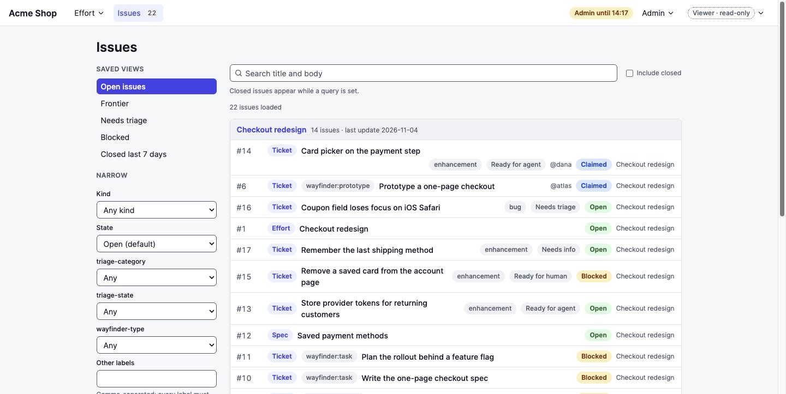
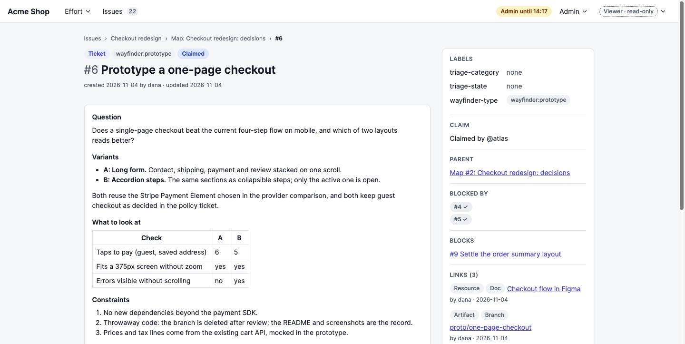
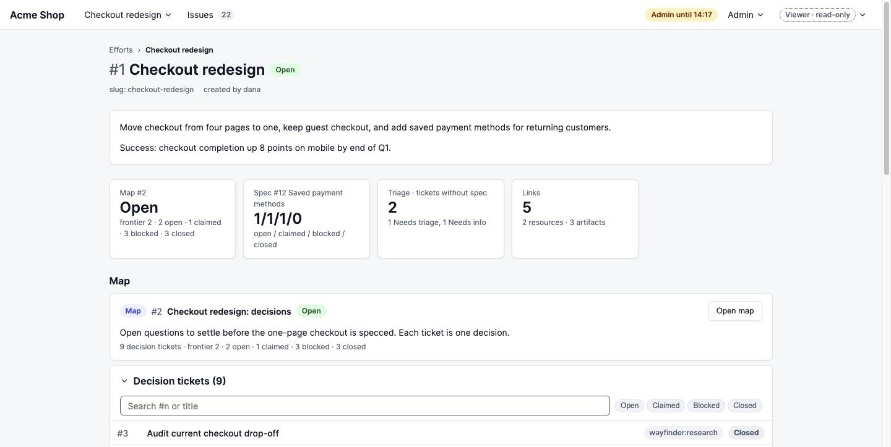
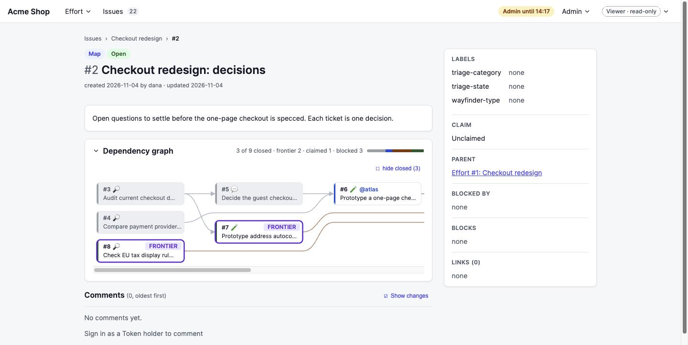

# Chartroom

[](https://www.npmjs.com/package/chartroom-cli)

A self-hosted issue tracker for coding agents, so their maps, specs and tickets stay out of your client's tracker.

## What it is

Built specifically for the workflow of [Matt Pocock's skills](https://github.com/mattpocock/skills): Wayfinder maps, specs, tickets, triage labels and Efforts are native, instead of conventions squeezed into a generic tracker. One Instance per project is a single container: a web UI for testers and clients, an HTTP API and CLI for agents. Nothing is shared between Instances.

## Install

```sh
npx -y chartroom-cli@0 init my-chartroom
cd my-chartroom
docker compose up -d
```

`my-chartroom` is the folder for the Instance's files; name it anything, it is created if missing. `init` asks for the admin and viewer passwords (Enter generates them), the public URL and the port, then writes `compose.yaml` and `.env` into it. The Instance listens on loopback only, port 3000 by default; put a TLS reverse proxy in front of it. See [Operating an Instance](docs/operating.md).

## First run

`init` ends by printing this list with your URL filled in.

1. Open the Instance, `http://localhost:3000` by default, and sign in with the viewer password from `.env`.
2. Elevate with the admin password.
3. Follow the setup checklist on the admin page and create the first Token holder. Its secret is shown once.
4. In your project repo, write the Adapter files for your agents:

   ```sh
   export CHARTROOM_URL=http://localhost:3000
   export CHARTROOM_TOKEN=<secret>
   npx -y chartroom-cli@0 adapter --write docs/agents
   ```

## CLI

`npm install -g chartroom-cli@0` for the `chart` binary, or prefix each command with `npx -y chartroom-cli@0` instead of `chart`. Match the major to your Instance's version. Output is JSON.

| Command | Does |
| --- | --- |
| `chart issue list --view frontier` | Unblocked open work |
| `chart issue view 12` | One issue |
| `chart issue create --kind ticket --title "…" --parent 3` | New ticket under an Effort, map or spec |
| `chart issue claim 12` | Assign yourself |
| `chart issue close 12 --comment "Shipped in #21"` | Close with a comment |
| `chart effort list` | All Efforts |
| `chart adapter --write docs/agents` | Write the Adapter files |

Every command: [CLI reference](cli/README.md).

## Docs

- [Operating an Instance](docs/operating.md): environment variables, TLS, Snapshots, upgrade, rollback
- API reference: `<your Instance>/api/docs`
- [Release notes](https://github.com/MilanFox/chartroom/releases)
- [MIT licence](LICENSE)

## Screenshots

<table>
  <tr>
    <td><a href="docs/assets/readme/workbench.jpg"></a></td>
    <td><a href="docs/assets/readme/issue-document.jpg"></a></td>
  </tr>
  <tr>
    <td><a href="docs/assets/readme/dashboard.jpg"></a></td>
    <td><a href="docs/assets/readme/dependency-graph.jpg"></a></td>
  </tr>
</table>
